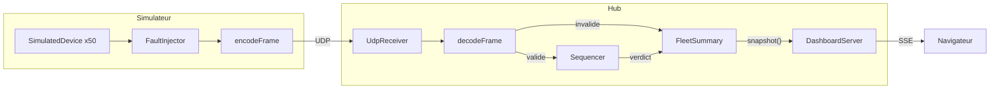

# PulseHub

Hub de télémétrie UDP et simulateur d'appareils (rattrapage Master Tech-Lead/CTO).
Le hub reçoit les trames de centaines d'équipements, écarte les trames invalides, les doublons et les retards, puis affiche en direct une synthèse de la flotte dans le navigateur.


## 1. Démarrage local

**Prérequis** : Node.js 20 ou plus, npm, Git. Aucun autre outil.

```bash
git clone https://github.com/imane-git1/pulsehub.git
cd pulsehub
npm install
```

| Action | Commande |
|---|---|
| Lancer le hub (UDP 9000 + tableau de bord) | `npm run hub` |
| Ouvrir la visualisation | http://127.0.0.1:3000 |
| Lancer le simulateur (50 appareils, 20 Hz, sans défaut) | `npm run sim` |
| Simulateur avec tous les défauts | `npm run sim -- --faults` |
| Tests | `npm test` |
| Vérification des types | `npm run typecheck` |

**Test d'acceptation en 1 minute** : lancer `npm run hub`, ouvrir le navigateur (tout est à zéro, « Aucun appareil reçu »), puis dans un second terminal `npm run sim -- --faults`. Les compteurs bougent, 50 tuiles apparaissent, les invalides montent, les appareils #1 et #2 passent en silencieux puis hors-ligne après 10 s, et le compteur de redémarrages augmente toutes les 15 s.

### Options du simulateur

`npm run sim -- --help` affiche l'aide complète.

| Option | Défaut | Effet |
|---|---|---|
| `-n, --devices` | 50 | nombre d'appareils |
| `-f, --rate` | 20 | trames par seconde et par appareil |
| `--host`, `-p, --port` | 127.0.0.1, 9000 | destination |
| `--bad-checksum <0-1>` | 0 | probabilité de checksum faux |
| `--duplicate <0-1>` | 0 | probabilité de doublon |
| `--reorder <0-1>` | 0 | probabilité de trame désordonnée |
| `--anomaly <0-1>` | 0 | probabilité de température anormale (90 à 120 °C) |
| `--stop <k>`, `--stop-after <s>` | 0, 10 | k appareils s'arrêtent après s secondes |
| `--restart <k>`, `--restart-every <s>` | 0, 15 | k appareils redémarrent périodiquement |
| `--faults` | non | preset de démonstration (tous les défauts) |

### Configuration du hub (variables d'environnement)

| Variable | Défaut | Rôle |
|---|---|---|
| `UDP_HOST` / `UDP_PORT` | `0.0.0.0` / `9000` | écoute UDP |
| `HTTP_HOST` / `HTTP_PORT` | `127.0.0.1` / `3000` | tableau de bord |
| `HOT_THRESHOLD_C` | `70` | seuil « chaud » en °C |
| `HOT_HOLD_MS` | `5000` | durée de maintien du statut chaud |
| `SILENT_AFTER_MS` | `2000` | délai avant « silencieux » |
| `OFFLINE_AFTER_MS` | `10000` | délai avant « hors-ligne » |
| `RATE_WINDOW_S` | `5` | fenêtre de calcul du débit |
| `SNAPSHOT_INTERVAL_MS` | `1000` | fréquence de rafraîchissement |
| `RESTART_TOLERANCE_MS` | `1000` | recul d'uptime à partir duquel on parle de redémarrage |

Exemple sous PowerShell : `$env:UDP_PORT=9001; npm run hub` (et `npm run sim -- -p 9001`).
Sous Linux/macOS : `UDP_PORT=9001 npm run hub`.

## 2. Architecture



**Parcours d'une trame** : le simulateur génère une trame (`SimulatedDevice`), éventuellement altérée (`FaultInjector`), puis l'encode en binaire et l'envoie en UDP. Le hub la reçoit (`UdpReceiver`), la décode et la valide (`decodeFrame`). Si elle est invalide, la cause est comptée. Sinon, le `Sequencer` décide si elle est acceptée, quel est le nombre de pertes détectées, et si l'appareil a redémarré. `FleetSummary` met à jour les compteurs et l'état de l'appareil. Chaque seconde, `DashboardServer` envoie un instantané (`snapshot()`) au navigateur par SSE, et la page se redessine.

```
src/protocol/   codec binaire (types, checksum, decode, encode)
src/hub/        config, udp-receiver, sequencer, fleet-summary, main (assemblage)
src/web/        dashboard-server (HTTP + SSE), public/index.html
src/simulator/  device, faults, main (CLI)
test/           tests du décodeur, du séquenceur et de la synthèse
```

## 3. Synthèse et visualisation

**Ce que la synthèse calcule**

- **Santé de la réception** : trames acceptées, écartées (doublons et retards), perdues, invalides (avec la cause), taux de perte, débit en trames/s, redémarrages d'appareils détectés.
- **État de chaque appareil** : `ok`, `hot` (chaud), `silent` (silencieux) ou `offline` (hors-ligne), avec dernière température, tension, courant, uptime et ancienneté de la dernière trame.
- **Compteurs par statut** pour la flotte.

**Pourquoi c'est utile à une régie** : elle doit savoir en quelques secondes quel équipement chauffe, lequel ne répond plus, et si la réception est saine. Les statuts évitent de lire 50 lignes de chiffres, et la distinction silencieux / hors-ligne sépare un trou passager d'une vraie panne. Le statut « chaud » est maintenu 5 s après un pic : une anomalie ne dure qu'une trame (50 ms), et sans maintien elle serait invisible à l'écran. Le taux de perte indique si c'est le réseau et non les appareils qui pose problème.

**Pourquoi une page web alimentée par SSE** : c'est le meilleur rapport lisibilité / temps pour une journée. Le serveur utilise uniquement le module `http` de Node, sans framework ni dépendance. SSE suffit puisque le flux va dans un seul sens (hub vers navigateur), et `EventSource` gère la reconnexion tout seul. Une interface terminal aurait été plus rapide à écrire, mais moins lisible pour 50 appareils. NestJS a été écarté : il apporte de la structure dont un si petit projet n'a pas besoin.

## 4. Principes de conception

| Principe | Explication | Code |
|---|---|---|
| Séparation des responsabilités | Chaque module n'a qu'un rôle : décoder, séquencer, synthétiser, servir. Aucun ne connaît les autres sauf par son interface. | [decode.ts](https://github.com/imane-git1/pulsehub/blob/1889d57c39aec407d9401309d2713372872cada8/src/protocol/decode.ts#L17-L52), [sequencer.ts](https://github.com/imane-git1/pulsehub/blob/1889d57c39aec407d9401309d2713372872cada8/src/hub/sequencer.ts#L15-L43) |
| Injection de dépendances | `UdpReceiver` reçoit ses callbacks, `DashboardServer` reçoit `getSnapshot`, `FleetSummary` reçoit ses options et l'horloge (`now`). Rien n'est instancié en dur à l'intérieur. | [udp-receiver.ts](https://github.com/imane-git1/pulsehub/blob/1889d57c39aec407d9401309d2713372872cada8/src/hub/udp-receiver.ts#L5-L13), [dashboard-server.ts](https://github.com/imane-git1/pulsehub/blob/1889d57c39aec407d9401309d2713372872cada8/src/web/dashboard-server.ts#L13-L14) |
| Composition root | Le seul endroit où les composants sont assemblés est `main.ts`. | [hub/main.ts](https://github.com/imane-git1/pulsehub/blob/1889d57c39aec407d9401309d2713372872cada8/src/hub/main.ts#L7-L19) |
| Gestion d'erreurs par valeur | Le décodeur renvoie `{ ok, error }` au lieu de lancer une exception : une trame invalide est un cas normal en UDP, elle est comptée par cause et ne peut pas faire planter le hub. | [decode.ts](https://github.com/imane-git1/pulsehub/blob/1889d57c39aec407d9401309d2713372872cada8/src/protocol/decode.ts#L11-L15) |
| Configuration externe | Ports, seuils et délais viennent de variables d'environnement, avec valeurs par défaut et validation. | [config.ts](https://github.com/imane-git1/pulsehub/blob/1889d57c39aec407d9401309d2713372872cada8/src/hub/config.ts#L13-L37) |
| DRY | Les constantes du protocole sont définies une fois et partagées par le décodeur, l'encodeur et le simulateur. | [types.ts](https://github.com/imane-git1/pulsehub/blob/1889d57c39aec407d9401309d2713372872cada8/src/protocol/types.ts#L1-L12) |
| KISS | Séquenceur en trois cas, SSE plutôt que WebSocket, serveur `http` natif, pas de framework. | [sequencer.ts](https://github.com/imane-git1/pulsehub/blob/1889d57c39aec407d9401309d2713372872cada8/src/hub/sequencer.ts#L20-L42) |
| Testabilité | Horloge injectée, fonctions pures, encodeur réutilisé pour les tests aller-retour. | [fleet-summary.test.ts](https://github.com/imane-git1/pulsehub/blob/1889d57c39aec407d9401309d2713372872cada8/test/hub/fleet-summary.test.ts#L31-L39) |

## 5. Choix et compromis

**Outils retenus** : TypeScript strict, `tsx` pour exécuter sans étape de build, `vitest` pour les tests, `node:dgram`, `node:http`, `node:util.parseArgs`. Le décodage utilise uniquement `Buffer` (`readUInt16BE`, `readInt16BE`, `readUInt32BE`).

**Outils écartés** : NestJS (trop lourd pour une journée), WebSocket (communication unidirectionnelle suffisante), bibliothèque de CLI et de configuration (`parseArgs` et `process.env` suffisent), ESLint et CI (par manque de temps).

**Gestion des pertes**
- Le séquenceur compte `seq − dernier − 1` pertes quand il voit un trou, et écarte toute trame dont le `seq` est inférieur ou égal au dernier.
- La première trame d'un appareil ne compte aucune perte : si le hub démarre après les appareils, leur `seq` est déjà élevé.
- Comparaison de `seq` circulaire sur 32 bits, donc le passage de 4 294 967 295 à 0 est géré.
- Un redémarrage est détecté quand `uptimeMs` recule de plus que la tolérance (1 s). La tolérance évite de confondre un redémarrage avec une trame simplement désordonnée.

**Simplifications assumées**
- Une trame désordonnée est d'abord comptée comme perdue (quand la suivante arrive), puis écartée quand elle arrive. Le compteur de pertes est donc un peu surestimé en présence de désordre. Corriger demanderait un tampon de réordonnancement, donc de la latence et de la complexité.
- Une trame écartée ne rafraîchit pas la date de dernière réception : un doublon retardé ne prouve pas que l'appareil est vivant maintenant.
- Les compteurs sont cumulés depuis le démarrage du hub, sans fenêtre glissante (sauf le débit).

## 6. Limites connues

- Le simulateur tourne à environ 16 Hz sous Windows au lieu de 20 : la précision de `setInterval` est limitée à ~15 ms. Pour être exact, il faudrait calculer le nombre de trames dues d'après le temps écoulé.
- Pas de persistance : tout est perdu à l'arrêt du hub. Pas d'historique consultable.
- Pas d'alertes avec condition de durée, pas de chaîne de traitement configurable, pas de mesure du débit maximal, pas d'intégration continue ni de linter.
- Un redémarrage survenant moins d'une seconde après le démarrage de l'appareil n'est pas détecté, et `uptimeMs` boucle lui-même au bout de 49,7 jours.
- Le noyau peut perdre des datagrammes UDP si le buffer de réception déborde : ces pertes ne sont pas visibles du hub (elles apparaissent comme trous de séquence si l'appareil envoie ensuite).
- Le tableau de bord n'a pas d'authentification : il écoute sur `127.0.0.1` par défaut et ne doit pas être exposé tel quel sur le réseau du lieu.
- Seuls le décodeur, le séquenceur et la synthèse sont testés. Le récepteur UDP, le serveur web et le simulateur sont vérifiés manuellement.
- La grille du tableau de bord est reconstruite entièrement à chaque message : correct pour 50 appareils, pas pour des milliers.

## 7. Usage de l'IA

J'ai utilisé **Claude (Anthropic)** pendant la journée pour : planifier l'architecture, expliquer le sujet et la logique de séquencement, générer une première version du code (décodeur, simulateur, séquenceur, synthèse, serveur SSE, page HTML) et corriger des erreurs de test. J'ai ensuite écrit les fichiers, lancé les tests, fait les commits et vérifié le comportement à l'exécution. Les décisions d'architecture (SSE, statuts, seuils, gestion des pertes) ont été discutées et je peux justifier chaque ligne livrée.
